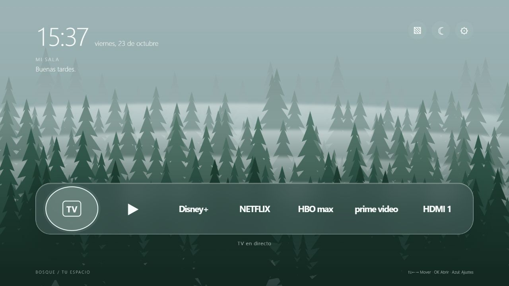
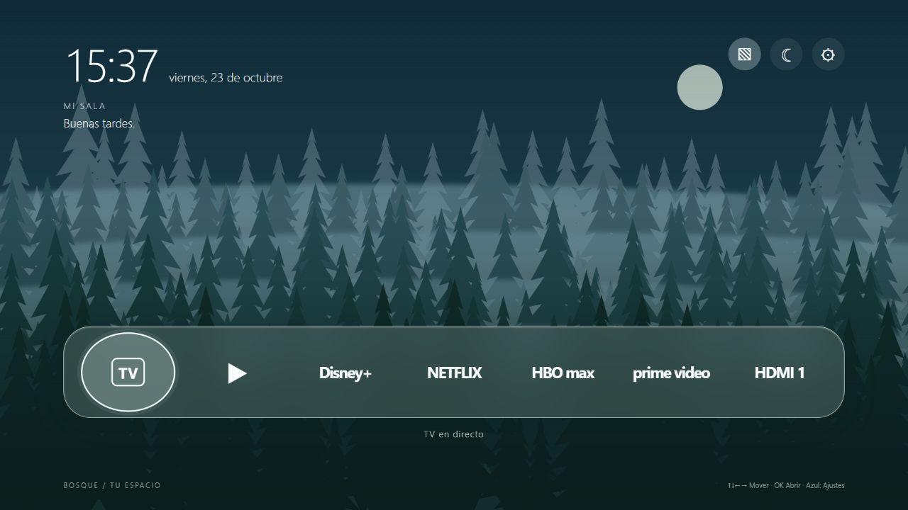
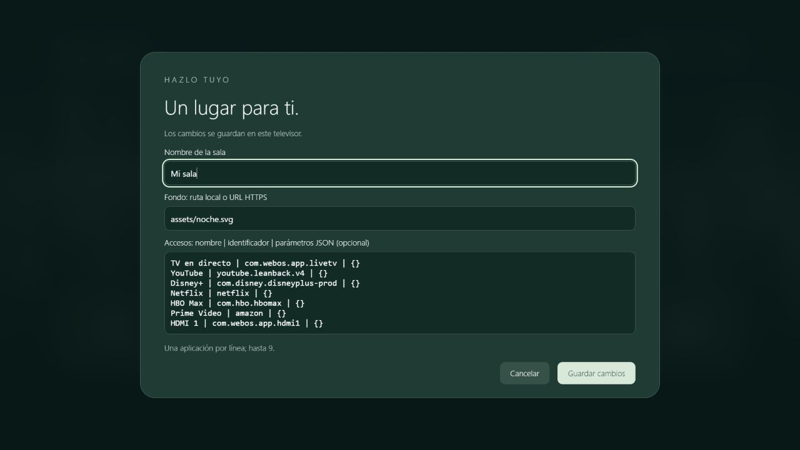

# Bosque · Launcher para LG webOS
Una pantalla de inicio tranquila: bosque con niebla, reloj y fecha en español y una barra translúcida de aplicaciones. Inspirado en la referencia visual aportada, con ilustraciones originales incluidas. Sin Home Assistant ni servidor permanente.

**Primera versión experimental. Pendiente de validación en un televisor físico.** La vista previa en ordenador no abre aplicaciones del TV.

## Así se ve

Capturas reales de la aplicación en la vista previa de navegador. El aspecto puede variar según el motor gráfico del televisor.

### Bosque con niebla



### Ambiente nocturno



### Ajustes por televisor



## Incluye
- Dos fondos vectoriales originales: bosque y noche.
- Reloj, fecha y saludo en español.
- Accesos configurables a aplicaciones y entradas HDMI.
- Navegación con flechas, OK, puntero Magic Remote y teclado.
- Ajustes guardados por televisor y modo ambiente.
- Tutorial y prompt para personalizar con IA.

## Empieza aquí
Lee el [tutorial de instalación](docs/INSTALACION.md).
Para ver el diseño instala Node.js LTS, abre una terminal en esta carpeta y ejecuta:

```sh
npm run preview
```

Abre http://127.0.0.1:4173. Para instalar en el TV sigue el tutorial completo.

[Prompt reutilizable](docs/PROMPT.md) · [Compatibilidad y problemas](docs/COMPATIBILIDAD.md)

## Controles
| Acción | Mando |
| --- | --- |
| Elegir acceso | Izquierda / derecha |
| Herramientas / dock | Arriba / abajo |
| Abrir | OK |
| Ajustes | Botón azul (406) o ⚙ |
| Cerrar ajustes | Atrás |
| Volver al sistema | Atrás desde la pantalla principal |
| Salir de modo ambiente | Cualquier tecla |

Dentro de ajustes, arriba/abajo recorre campos y botones; en el cuadro de aplicaciones las flechas editan el texto. Tab y Mayús+Tab recorren el diálogo.

## Límites
Bosque es una aplicación instalable. No reasigna Inicio, no garantiza arranque automático ni sustituye el launcher de LG. No requiere root.
Developer Mode caduca: renueva la sesión antes de que termine; al desactivarse, LG desinstala las apps de desarrollo.

Los IDs incluidos son ejemplos y pueden variar por región, versión o instalación. Aplicaciones privilegiadas como TV/HDMI pueden rechazar el lanzamiento desde Developer Mode.
No incluye clima ni datos domésticos simulados. No se redistribuyen la fotografía ni los logotipos de la referencia; los nombres identifican los accesos.

## Desarrollo
```sh
npm install
npm test
npm run check
npm run package
```
La biblioteca oficial de LG está incluida con su licencia. El código usa JavaScript conservador y un panel semitransparente como alternativa al desenfoque.

## Licencia
Código e ilustraciones: MIT, consulta LICENSE. webOSTV.js 1.2.13 se incluye sin modificaciones con su licencia Apache 2.0 en app/vendor/. Proyecto comunitario sin afiliación a LG ni a los servicios mencionados.
